# 强制报告智能体界面预览

以下为登录首页及访客进入后的主要页面截图。截图采集于 2026 年 10 月 19 日至 25 日，电脑端视口为 **1440 × 900**，另附手机端地区选择示例。

从登录页右上角点击“先以访客使用”，即可进入公众服务。访客无需注册，可使用智能问答、情景实训、普法学习和报告表单，并查看当前浏览器的记录与培训台账。

## 登录首页

首页提供登录、注册和访客使用入口，底部另有公安及协同部门的接收工作台入口。

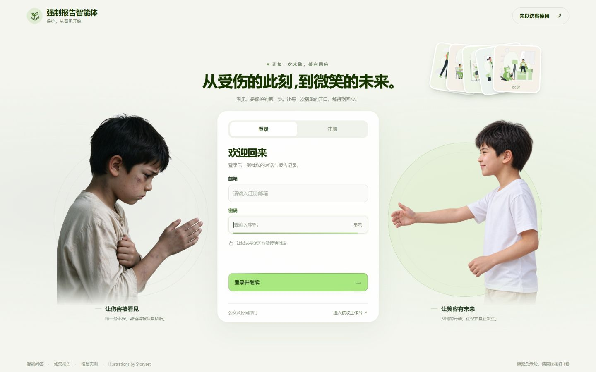

## 访客智能问答

访客进入后默认打开智能问答页。页面包含公众服务导航、模型选择、最近对话和智能助手欢迎区，快捷问题每 4 秒轮换。“从对话整理报告”和“填写表单”固定在对话卡片顶部；电脑端保留较高的对话区域，允许整页滚动，长对话也可在卡片内部滚动。

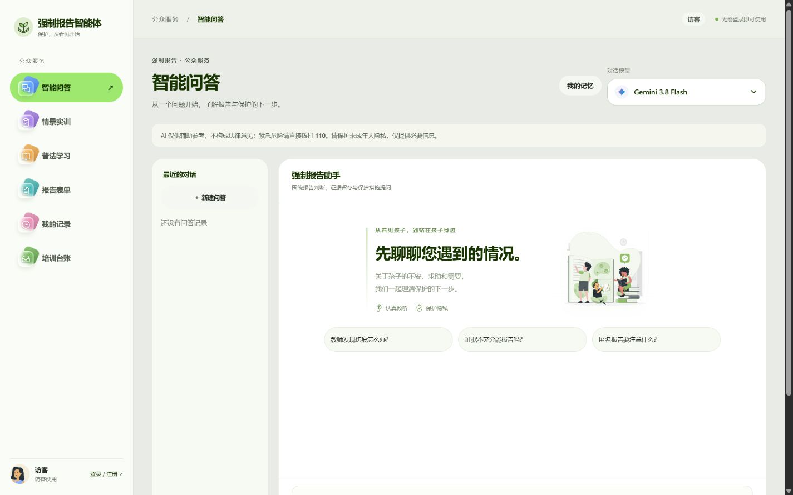

## 对话转报告核对

手动整理和对话工具共用原话抽取流程。候选信息显示出处，转述与推测单独标为待核实；用户逐项选择、修改并确认后才进入表单。下图为虚构功能测试数据，不是实际线索。

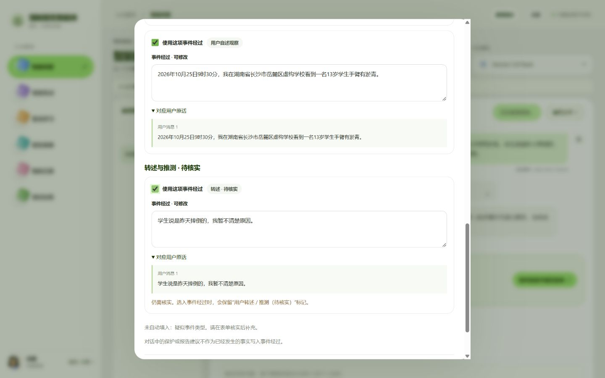

## 情景实训

通过九个虚构案例练习风险识别、沟通和报告判断，新增家庭暴力目睹、未成年博主网络侵害、多重风险和不愿开口场景。案例卡片标明岗位、角色和难度；下图为原有案例区。

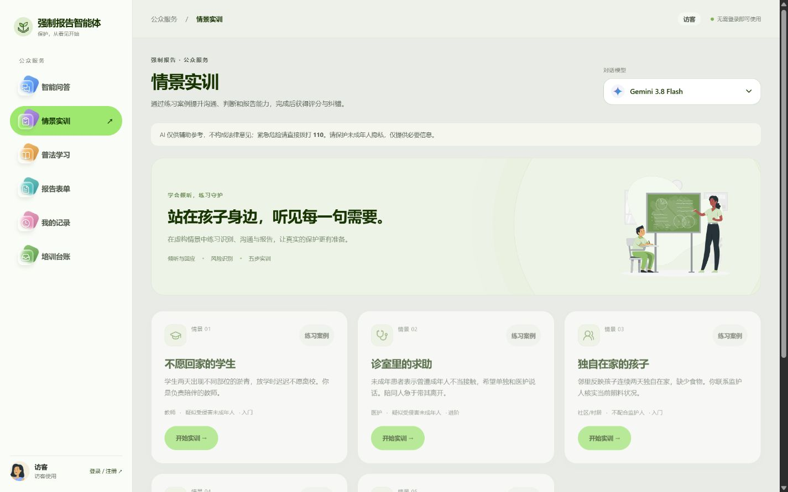

## 普法学习

学习页以要点卡片、实操问答和短案例呈现报告制度、证据留存及隐私保护等内容，并提供来源链接和学习完成记录入口。横幅采用点赞姿态的守护形象。

阅读卡片后，点击卡片或练习入口即可进入独立的同主题练习页面，无需计时和阅读确认。每节三道单选题，提交后自动评分并给出逐题解析；支持重新练习、最高分与知识掌握记录，并提供对应实训入口。

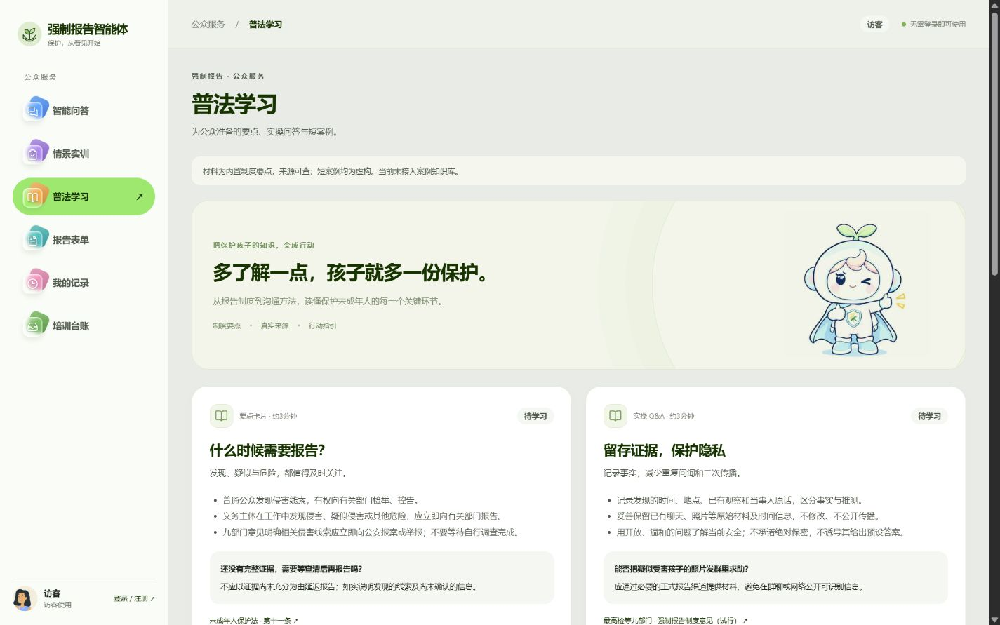

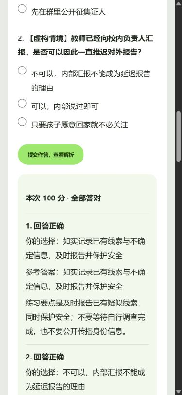

## 图片问答与模型说明

所选模型通过无隐私测试图验证后，可添加图片辅助问答。模型列表显示中文用途、图片验证状态和实际测量的耗时；下图仅使用合成色块图。

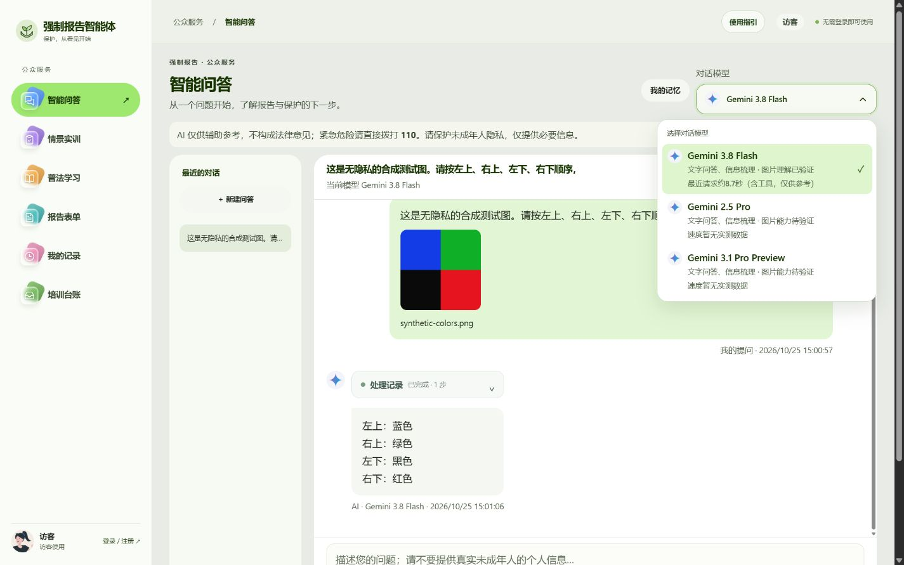

实训中安全保护问题已经前置，沟通题提供明确题干，评分后另有逐项解析。

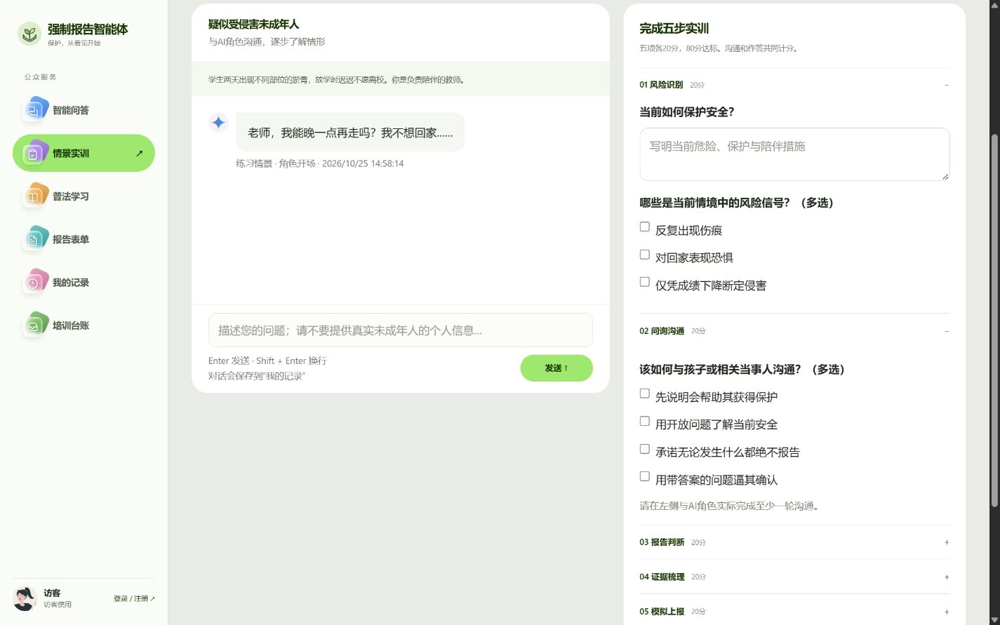

## 报告表单

报告表单按身份与事件、事件详情、证据与联系分区填写，支持草稿保存。截图为尚未填写的首屏，右侧使用伸手保护姿态的形象，配合报告引导信息。

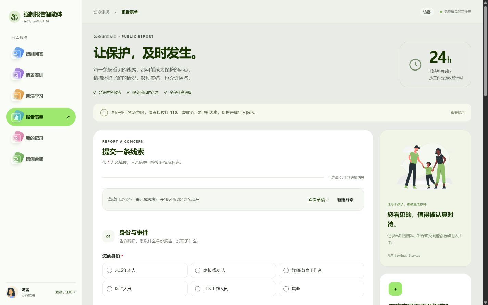

事件描述框下提供可展开的虚构填写示例，提醒区分观察、原话与待核实信息。

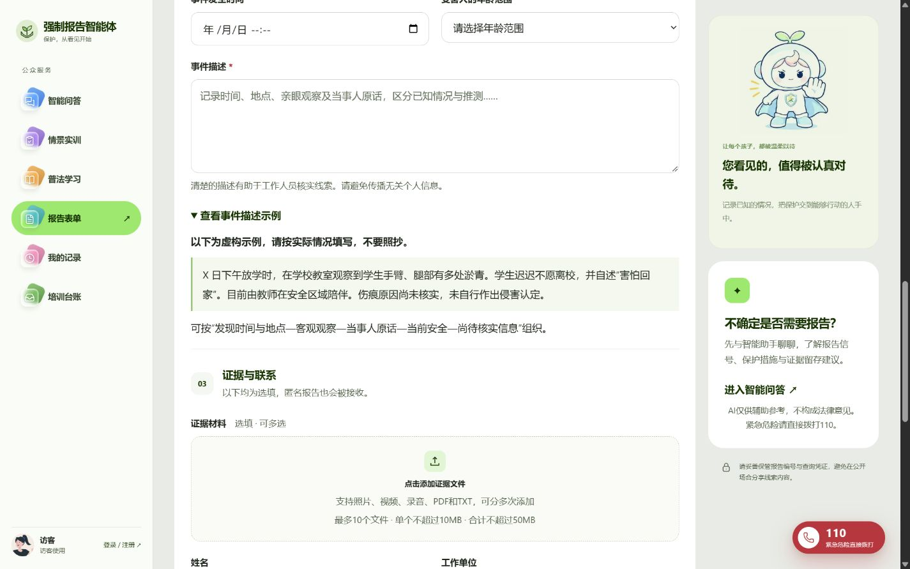

证据可批量或分次添加、逐项移除，并随草稿恢复；最多 10 个文件，单个 10MB、合计 50MB。接收端按文件提供下载入口。下图使用虚构测试材料。

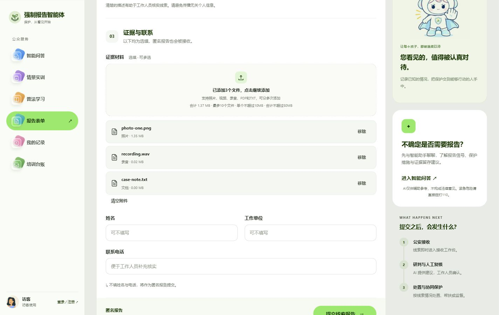

省、市、区县采用联动下拉，变更上级会清空下级选项。地区数据采用 2024 年基线；港澳台目前提供省级选项，具体地点填写在详细地址中。

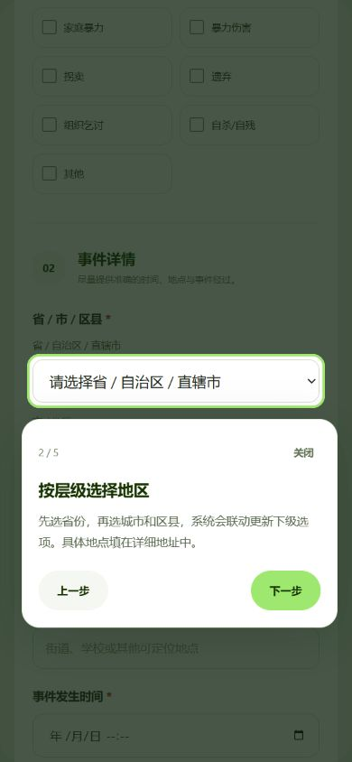

## 使用指引

首次访问显示使用提示，顶部“使用指引”可随时重新打开。指引通过高亮说明页面操作，支持上一步、下一步、关闭和键盘退出。

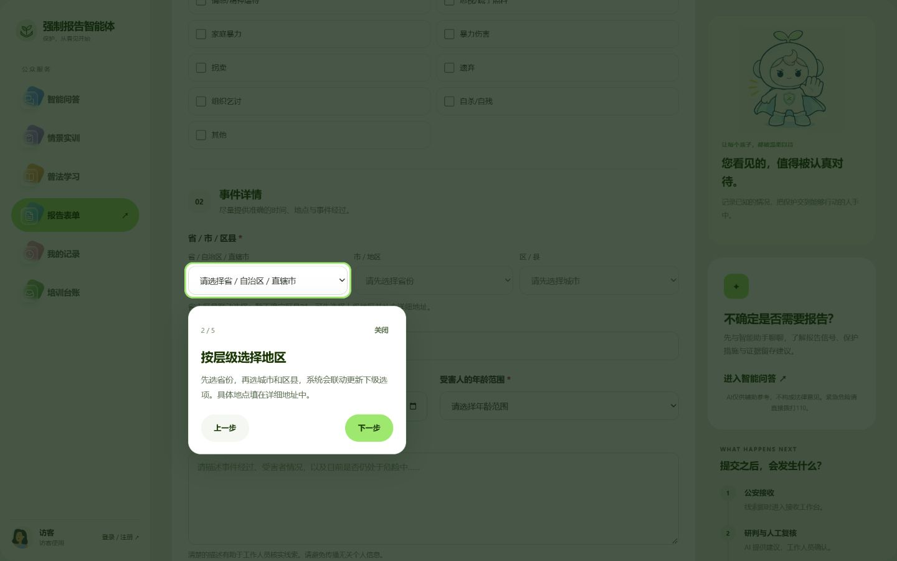

## 我的记录

按草稿、问答、实训、学习和上报分类查看记录。截图展示新访客尚未产生记录时的初始状态。

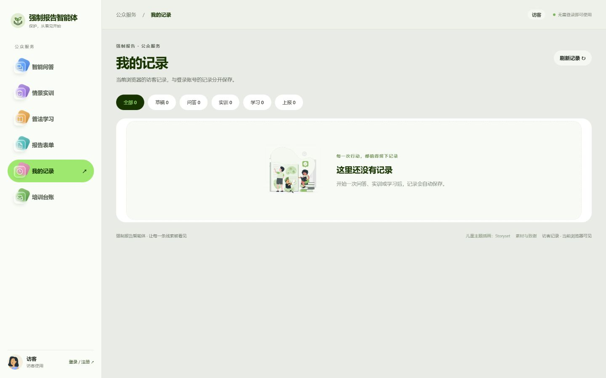

## 培训台账

汇总当前用户的实训完成、达标和学习完成情况，并提供台账导出入口。截图展示新访客的初始空台账。

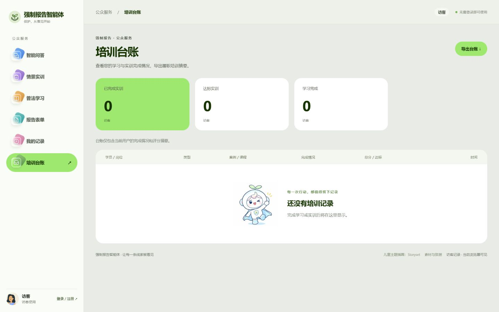

---

[返回项目说明](../README.md)
